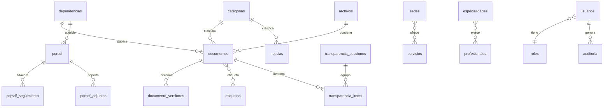

# Sitio web E.S.E. Hospital Rosario Pumarejo de López
## Mapa del sitio y modelo de datos mínimo

**Alcance:** sitio web institucional + panel de administración mínimo. Sin multi-tenant, sin CMS como producto, sin IA, sin integración con HIS.

---

## Parte 1 — Restricciones normativas que condicionan el diseño

Estas no son preferencias. Son obligaciones que definen la estructura antes de cualquier decisión estética.

| Norma | Qué obliga | Impacto en el diseño |
|---|---|---|
| Ley 1712 de 2014 | Publicar y mantener actualizada información pública mínima | Existe una sección de Transparencia con estructura fija |
| Resolución 1519 de 2020 (MinTIC), Anexo 2 | Estandariza encabezado, pie de página, menú de Transparencia, menú de Atención y Servicios a la Ciudadanía, menú Participa y sección de Noticias | La navegación superior **no es libre**: hay elementos obligatorios |
| Resolución 1519, Anexo 1 | WCAG 2.1 nivel **AA**, exigible desde el 1 de enero de 2022 | Contraste, teclado, semántica, foco visible: no opcional |
| Resolución 1519, Art. 2 | Formulario electrónico de PQRSD con campos mínimos definidos en el Anexo 2 | El formulario tiene campos que no puedes omitir aunque incomoden |
| Ley 1755 de 2015 | Términos de respuesta al derecho de petición | El sistema debe calcular vencimientos en días hábiles |
| Ley 1581 de 2012 | Habeas data; los datos de salud son sensibles | Autorización explícita registrada en cada formulario |

> **Verificar antes de codificar:** la versión vigente del Anexo 2 y los campos mínimos exactos del formulario PQRSD, junto con la oficina jurídica y de planeación del hospital. La Resolución ha tenido actualizaciones posteriores y el detalle de subsecciones cambia.

**Consecuencia práctica:** la idea de una home con solo ocho botones sigue siendo correcta *como jerarquía visual*, pero el encabezado y el pie deben contener los elementos exigidos. La solución es separar **prominencia** de **presencia**: lo obligatorio existe y es accesible; lo que el ciudadano busca es lo que domina la pantalla.

---

## Parte 2 — Mapa del sitio

### Encabezado (todas las páginas)

Logo · Buscador · Transparencia · Atención y Servicios a la Ciudadanía · Participa · Menú principal · Botón de accesibilidad · Enlace a PQRSDF

### Home — jerarquía visual

**Bloque 1 · Acciones (lo único destacado, máximo 8):**
Citas · Urgencias · Especialidades · Directorio médico · Trámites · Resultados · PQRSDF · Transparencia

**Bloque 2:** Aviso activo (urgencias / campaña / emergencia) — condicional
**Bloque 3:** Noticias recientes (3)
**Bloque 4:** Sedes y teléfonos
**Bloque 5:** Pie de página normativo completo

### Estructura de URLs

```
/
├── /citas                              Cómo agendar (informativo en v1)
├── /urgencias                          Ubicación, teléfonos, qué es una urgencia
├── /especialidades
│   └── /especialidades/{slug}
├── /servicios
│   └── /servicios/{slug}
├── /directorio                         Directorio médico
│   └── /directorio/{slug}
├── /sedes
│   └── /sedes/{slug}
│
├── /atencion-ciudadania                ← menú obligatorio Res. 1519
│   ├── /atencion-ciudadania/tramites
│   │   └── /atencion-ciudadania/tramites/{slug}
│   ├── /atencion-ciudadania/pqrsdf
│   │   ├── /atencion-ciudadania/pqrsdf/radicar
│   │   └── /atencion-ciudadania/pqrsdf/consultar
│   ├── /atencion-ciudadania/preguntas-frecuentes
│   ├── /atencion-ciudadania/canales
│   └── /atencion-ciudadania/derechos-deberes
│
├── /participa                          ← menú obligatorio Res. 1519
│   ├── /participa/rendicion-de-cuentas
│   ├── /participa/consulta-ciudadana
│   └── /participa/asociacion-usuarios
│
├── /transparencia                      ← menú obligatorio Res. 1712 / 1519
│   ├── /transparencia/informacion-entidad
│   ├── /transparencia/normatividad
│   ├── /transparencia/contratacion
│   ├── /transparencia/planeacion-presupuesto-informes
│   ├── /transparencia/tramites-servicios
│   ├── /transparencia/participa
│   ├── /transparencia/datos-abiertos
│   ├── /transparencia/grupos-de-interes
│   └── /transparencia/reportes-obligatorios
│
├── /noticias
│   ├── /noticias/{slug}
│   └── /noticias/categoria/{slug}
├── /campanas
│   └── /campanas/{slug}
├── /convocatorias
│   └── /convocatorias/{slug}
├── /documentos                         Buscador documental
│   └── /documentos/{id}-{slug}
│
├── /institucional
│   ├── /institucional/quienes-somos
│   ├── /institucional/mision-vision
│   ├── /institucional/organigrama
│   ├── /institucional/directivos
│   └── /institucional/historia
│
├── /contacto
├── /buscar
├── /accesibilidad
├── /mapa-del-sitio
├── /politica-tratamiento-datos
└── /politica-privacidad-web
```

**Panel administrativo:** `/admin/{dashboard, noticias, documentos, transparencia, directorio, paginas, pqrsdf, convocatorias, avisos, usuarios, configuracion, auditoria}`

### Migración desde Joomla

El sitio actual tiene URLs citadas en documentos oficiales, correos y buscadores. **Antes de publicar** hay que inventariar las URLs existentes y crear redirecciones 301 hacia las nuevas. Sin esto se rompen enlaces en actos administrativos ya emitidos. Por eso hay una tabla `redirecciones` en el modelo.

---

## Parte 3 — Modelo de datos

### Convenciones

- MySQL 8, InnoDB, `utf8mb4_0900_ai_ci`
- Toda tabla: `id BIGINT UNSIGNED AUTO_INCREMENT`, `creado_en`, `actualizado_en`, `creado_por`, `actualizado_por`
- Borrado lógico (`eliminado_en`) en contenido, documentos y trámites. Nunca `DELETE` físico.
- **Sin `tenant_id`.** Decisión consciente, revertida respecto al diseño anterior de plataforma.

### Diagrama de relaciones principales



---

### Grupo A — Contenido

**`paginas`** — páginas institucionales editables
`slug` · `titulo` · `resumen` · `contenido` (HTML) · `padre_id` · `orden` · `plantilla` · `publicada` · `meta_titulo` · `meta_descripcion` · `imagen_id`

**`noticias`**
`slug` · `titulo` · `resumen` · `contenido` · `imagen_id` · `categoria_id` · `estado` (borrador/programada/publicada) · `publicada_en` · `destacada` · `vistas`

**`categorias`**
`tipo` (noticia/documento/campana) · `nombre` · `slug` · `orden` · `activa`

**`avisos`** — banner de urgencia, campaña o emergencia
`tipo` (urgencia/campana/emergencia/informativo) · `titulo` · `mensaje` · `url` · `nivel` (info/alerta/critico) · `desde` · `hasta` · `activo` · `prioridad`

> Un solo aviso crítico activo convierte la home en modo emergencia. Es la versión barata del "Módulo de Emergencias" del diseño original, y cuesta una tabla.

**`campanas`**
`slug` · `titulo` · `descripcion` · `imagen_id` · `inicio` · `fin` · `poblacion_objetivo` · `activa`

---

### Grupo B — Servicios y directorio

**`sedes`**
`nombre` · `slug` · `direccion` · `municipio` · `telefono` · `correo` · `horario` (JSON) · `latitud` · `longitud` · `tiene_urgencias` · `orden`

**`especialidades`**
`nombre` · `slug` · `descripcion` · `icono` · `activa` · `orden`

**`servicios`**
`nombre` · `slug` · `descripcion` · `requisitos` · `horario` · `activo`

**`profesionales`**
`nombre` · `slug` · `registro_rethus` · `foto_id` · `perfil` · `activo`

**Pivotes:** `servicio_sede`, `profesional_especialidad`, `profesional_sede`

> **Nota de datos personales:** el directorio médico publica datos de personas identificadas. Requiere autorización de cada profesional y una política clara sobre qué se publica. No publicar teléfonos ni correos personales.

---

### Grupo C — Gestión documental

Aquí está la diferencia real frente al sitio actual. Un PDF no es un archivo suelto: es un registro con metadatos.

**`dependencias`**
`nombre` · `sigla` · `responsable` · `correo` · `activa`

**`documentos`**
`titulo` · `slug` · `resumen` · `archivo_id` · `categoria_id` · `dependencia_id` · `fecha_documento` · `vigencia_desde` · `vigencia_hasta` · `numero_acto` · `version` · `estado` (borrador/vigente/derogado) · `reemplaza_a_id` · `descargas` · `publicado`

**`documento_versiones`**
`documento_id` · `version` · `archivo_id` · `notas` · `creado_por` · `creado_en`

**`etiquetas`** + **`documento_etiqueta`**

**`archivos`**
`nombre_original` · `ruta` · `mime` · `tamano` · `hash_sha256` · `subido_por`

> `vigencia_hasta` + `reemplaza_a_id` son lo que permite después detectar documentos vencidos y resoluciones derogadas todavía publicadas. Dos columnas hoy, un módulo de cumplimiento mañana.

---

### Grupo D — Transparencia

**`transparencia_secciones`** — estructura fija sembrada por migración
`codigo` (ej. `4.2`) · `nombre` · `descripcion` · `padre_id` · `orden` · `obligatoria` · `periodicidad` (ninguna/mensual/trimestral/semestral/anual) · `dependencia_id` · `ultima_actualizacion`

**`transparencia_items`**
`seccion_id` · `documento_id` (nullable) · `url_externa` (nullable) · `titulo` · `descripcion` · `orden` · `publicado`

> Modelar transparencia como datos y no como páginas HTML es lo que hace posible el semáforo de cumplimiento sin construirlo ahora. `periodicidad` + `ultima_actualizacion` ya contienen toda la información necesaria.

---

### Grupo E — PQRSDF

**`pqrsdf`**

| Campo | Notas |
|---|---|
| `radicado` | `HRPL-{AAAA}-{secuencia}`, único |
| `tipo` | peticion_general / peticion_informacion / consulta / queja / reclamo / sugerencia / denuncia / felicitacion |
| `canal` | web / presencial / telefonico / correo / buzon |
| `anonima` | booleano |
| `nombre`, `tipo_documento`, `numero_documento`, `correo`, `telefono`, `direccion`, `municipio` | Campos mínimos según Anexo 2 |
| `poblacion_especial` | Campo requerido para caracterización |
| `asunto`, `descripcion` | |
| `dependencia_id` | Área asignada |
| `estado` | recibida / en_tramite / trasladada / respondida / cerrada |
| `recibida_en`, `dias_termino`, `vence_en`, `respondida_en` | `vence_en` calculado en días hábiles |
| `medio_respuesta` | correo / fisico / telefono |
| `autorizacion_datos`, `autorizacion_ip`, `autorizacion_fecha` | Evidencia de habeas data |

**`pqrsdf_seguimiento`**
`pqrsdf_id` · `estado_anterior` · `estado_nuevo` · `nota` · `visible_ciudadano` · `usuario_id` · `creado_en`

**`pqrsdf_adjuntos`** — `pqrsdf_id` · `archivo_id` · `origen` (ciudadano/hospital)

**`festivos`** — `fecha` · `nombre`. Necesaria para calcular días hábiles correctamente.

> El tipo determina el término legal. La consulta pública por radicado solo muestra los seguimientos marcados `visible_ciudadano`.

**`convocatorias`**
`titulo` · `slug` · `tipo` (empleo/contratacion/otra) · `estado` (abierta/en_evaluacion/cerrada) · `apertura` · `cierre` · `descripcion` + pivote a `documentos`

---

### Grupo F — Sistema

**`usuarios`** — `nombre` · `correo` · `hash_password` · `rol_id` · `dependencia_id` · `activo` · `mfa_secreto` · `ultimo_acceso`

**`roles`** — `nombre` · `permisos` (JSON)
Roles iniciales: SuperAdmin · Comunicaciones · Atención al Usuario · Jurídica · Planeación · Talento Humano · Consulta

**`auditoria`** — `usuario_id` · `accion` · `entidad` · `entidad_id` · `antes` (JSON) · `despues` (JSON) · `ip` · `user_agent` · `creado_en`
Append-only. Sin update ni delete.

**`configuracion`** — `clave` · `valor` · `tipo` · `grupo`
Teléfonos, horarios, redes sociales, correo de notificaciones, textos legales, colores.

**`redirecciones`** — `origen` · `destino` · `codigo` (301/302) · `hits`

**`indice_busqueda`** — `tipo` · `entidad_id` · `titulo` · `contenido` · `url` · `actualizado_en`
Índice `FULLTEXT` sobre `titulo` + `contenido`. Un buscador único sin motor externo.

---

## Parte 4 — Lo que deliberadamente no está

| Fuera | Por qué |
|---|---|
| Agendamiento real de citas | Depende del HIS. En v1 `/citas` explica el procedimiento y da teléfonos |
| Resultados de laboratorio en línea | Datos clínicos sensibles. Requiere integración y análisis jurídico |
| Cuenta de usuario ciudadano | Sin trámites autenticados, no hay para qué |
| Motor de workflows | Los estados de PQRSDF son un enum, no un BPM |
| WhatsApp, IA, chat | Ninguno resuelve el problema de v1 |
| Turnos, kioscos, pantallas | Hardware y procesos internos que no existen aún |
| Multi-tenant | Un hospital. Se extrae cuando aparezca el segundo |

---

## Parte 5 — Orden de construcción sugerido

1. Base: esquema, migraciones, autenticación, roles, auditoría, configuración, archivos
2. Contenido: páginas, noticias, categorías, avisos + plantillas públicas
3. Directorio: sedes, especialidades, servicios, profesionales
4. Documental: documentos, versiones, etiquetas, buscador
5. Transparencia: estructura sembrada + vinculación de documentos
6. PQRSDF: formulario, radicado, bitácora, consulta pública, cálculo de términos
7. Buscador unificado, SEO, PWA, accesibilidad
8. Migración de contenido y redirecciones 301
9. Auditoría de accesibilidad AA y pruebas de rendimiento móvil

Los pasos 1 a 6 son el sitio funcional. Los pasos 7 a 9 son los que hacen que se note la diferencia frente al Joomla actual, y son los que típicamente se recortan por falta de tiempo. No los recortes.
